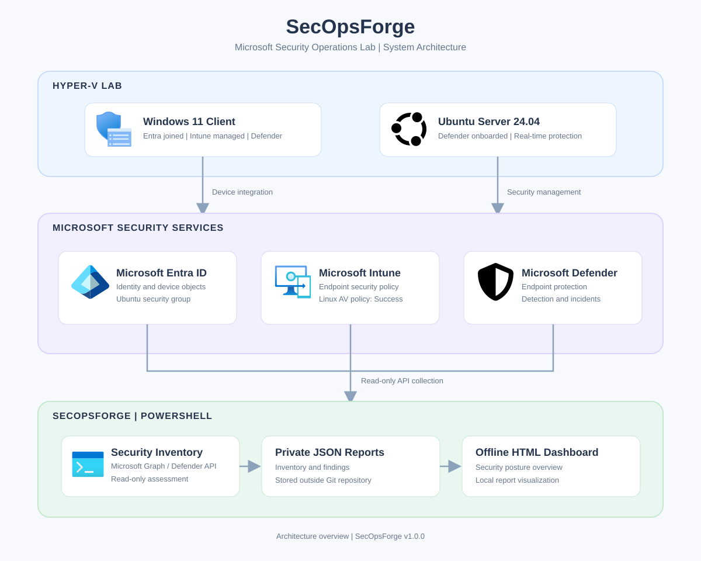

# Architecture

## Purpose

SecOpsForge is a defensive Microsoft security operations research lab and PowerShell reporting project. It combines a Microsoft 365 Business Premium lab tenant, Entra ID, Intune, Defender for Business, a Windows 11 Hyper-V lab endpoint, PowerShell 7, Pester, and GitHub Actions.

## Data flow

```text
Microsoft 365 lab tenant
  |
  |-- Microsoft Entra ID
  |     `-- Identity and privileged access
  |
  |-- Microsoft Intune
  |     `-- Device and policy inventory
  |
  |-- Microsoft Defender
  |     |-- Incident inventory (Microsoft Graph)
  |     `-- Device inventory (Defender API)
  |
  v
Read-only PowerShell inventory commands
  |
  v
Security review orchestration
  |
  |-- Private JSON: security-posture.json
  `-- Private JSON: security-assessment.json
  |
  v
Offline HTML renderer
  |
  v
Private security-report.html
```

The PowerShell module is located at `src/SecOpsForge/SecOpsForge.psm1`.

The security review orchestrator is `scripts/Invoke-SecOpsForgeSecurityReview.ps1`, and the offline HTML renderer is `scripts/New-SecOpsForgeHtmlReport.ps1`.

Microsoft Graph provides read-only identity, privileged access, Intune, and Defender incident inventory. Defender device inventory uses a separate read-only Defender API integration with the `Machine.Read.All` application permission.

When a valid Defender access token is supplied, the security review includes Defender device inventory as an additional reporting area. Without this token, the existing five-area reporting workflow remains supported.

The HTML renderer accepts `PosturePath`, `AssessmentPath`, and `OutputPath`. The Defender device inventory is informational and does not automatically generate security findings.

## Linux Endpoint Security Integration

Ubuntu Server 24.04 LTS runs as a separate Hyper-V endpoint alongside Windows 11.

The Linux security integration follows this flow:

Ubuntu Server (Hyper-V)
  -> Microsoft Defender for Endpoint
     -> Antivirus, real-time protection and incident investigation
     -> Security settings management (MDE)
  -> Microsoft Entra ID
     -> Device object associated with MDE
  -> Microsoft Intune
     -> Linux antivirus policy assigned to Ubuntu security group
     -> Intune policy assignment: Success

Ubuntu is not Entra-joined or conventionally enrolled in Intune.

This integration extends the security lab without adding new PowerShell module functions or claiming that Linux inventory has been validated in the SecOpsForge HTML report.

## Visual Architecture



## Trust boundaries

The Microsoft tenant is a lab source. Inventory operations are read-only.

Raw tenant-derived output stays in `$HOME/SecOpsForge-Private-Reports` outside the repository.

Authentication credentials, access tokens, and private tenant reports must not be committed to GitHub.

HTML is intended for offline viewing and must not require external scripts, fonts, or images.

The SVG icon loader validates local assets before embedding them as data URIs.

## Limitations

This is not a production SOC platform or a comprehensive security audit.

Reported findings and inventory counts depend on available permissions, data completeness, and the specific implemented checks.

A zero-finding result does not establish that an environment is secure.

Defender device inventory provides informational device data and does not replace a complete endpoint security assessment.
